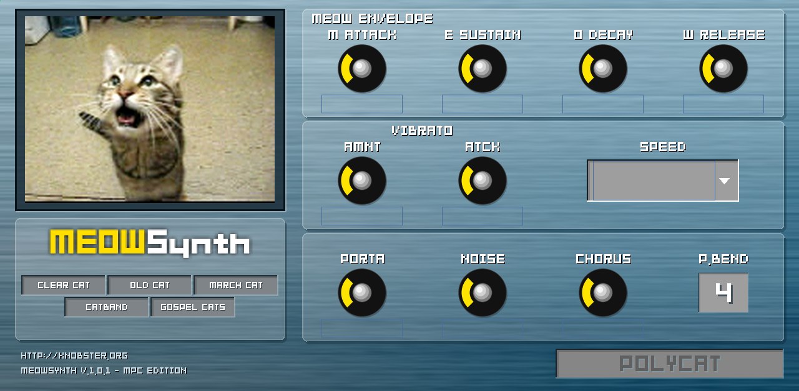

# MeowSynth for MPC OS



A native MPC plugin of knobster's **MeowSynth 1.0**, built with
[mpc-vst-plugins](https://github.com/sd88me/mpc-vst-plugins): track instrument, touchscreen page in the
original's look with the meowing cat, Q-Links, settings saved with the project.

It is a re-creation, not a conversion. `MeowSynth.dll` is 32-bit Windows x86 code and MPC OS loads ARM Linux
plugins only, so the DLL itself can never run there. What the DLL does contain is the author's whole SynthEdit
patch, and MeowSynth turns out to use no samples: this port rebuilds that patch in C, with the module maths
read out of the DLL (`re/NOTES.md`), and redraws the GUI from the DLL's own bitmaps.

**Sound:** checked against the real thing. The DLL runs under Wine on a Mac, and `re/ab/` plays the same
notes through it and through this engine: levels agree within a few tenths of a dB on every program, with the
same glides, vibrato and chorus behaviour (`re/NOTES.md`). `previews/ab_original_dll.wav` and
`previews/ab_mpc_port.wav` are the same phrase from each.

## Build and test
```
re/extract_assets.py ../MeowSynth.dll     # once: the original bitmaps -> assets/
./test.sh                                 # offline: host test + the cat check, must print PASSED twice
./test.sh aarch64                         # the same on Gen 2's CPU, in an arm64 container (QEMU)
./build.sh                                # Docker: art, skin, the Gen 1 and Gen 2 .so -> dist/ (or ./build.sh armv7|aarch64)
```
`build.sh` expects a checkout of mpc-vst-plugins next to this folder (or `MPC_VST=/path`), and Docker that can run
arm/v7 and arm64 containers (QEMU). It writes `dist/knobster - VST - MeowSynth/` (the Gen 1 plugin as one folder),
`dist/MeowSynth-1.0.2-mpc-armv7.zip` (Gen 1) and `dist/MeowSynth-1.0.2-mpc-aarch64.zip` (Gen 2), each with
mpc-vst-plugins' installer. Both zips go on the same release.

## Install
Needs root SSH on the MPC (a modded unit), as for every mpc-vst-plugins plugin. The installer stops and
restarts MPC and backs up `MPC.settings` first.

Pick the zip for your unit: **Gen 1** (Force, MPC Live / Live II, One, X, Key 61: 32-bit ARM) takes
`MeowSynth-<version>-mpc-armv7.zip`; **Gen 2** (MPC Live III and other RK3588 units: 64-bit, MPC OS 3.x) takes
`MeowSynth-<version>-mpc-aarch64.zip`. They are the same plugin with the same page, parameters and presets, so a
project moves between the two. The installer checks the zip against the unit (`uname -m`) and refuses the wrong one.

**Gen 2:** the zip's `install.sh` alone does not work there: its default `/sdcard/Synths` does not exist, `/synths` is
read-only, and cards and drives under `/media` are mounted `noexec`, so MPC cannot load a plugin from them. Use
`tools/gen2_install.sh`, which installs into `/nvme/Synths` (the internal user partition) and adds that folder to MPC's
skin locations (without that you get MPC's generic page of knobs instead of the cat):
```
unzip MeowSynth-<version>-mpc-aarch64.zip && scp -r MeowSynth-<version> root@<ip>:/tmp/
ssh root@<ip> 'sh -s -- /tmp/MeowSynth-<version>' < tools/gen2_install.sh
```
Then remove MeowSynth from the track and insert it again. Tested on an MPC Live III (MPC OS 3.9.1);
`docs/GEN2_PORTING.md` has the details.
- Installer app: drop the zip into the [MPC plugin installer](https://github.com/sd88me/mpc-vst-plugins/releases/latest).
- By hand: unzip on the device and run `sh install.sh` as root; `INSTALL.md` in the zip has the manual steps.
- Updating an installed copy when only the sound changed: replace `meowsynth.so` in
  `/sdcard/Synths/knobster - VST - MeowSynth/`, remove MeowSynth from every track, insert it again. No restart.

## Pages and Q-Links
| Page | Q-Links 1-4 | 5-8 | 9-12 | 13-16 |
|---|---|---|---|---|
| MEOW | M Attack, E Sustain, O Decay, W Release | Vib Amnt, Vib Atck, Vib Speed, Cat | Porta, Noise, Chorus, P.Bend | Polycat |
| FILTER | Cutoff, Resonance, Env Mod, Filter Mix | Follow Attack, Follow Decay, Gain, Filter Type | | |

On a 4-knob MPC each group is one Q-Link bank. With Q-Links set to follow the track instead of the screen:
the MEOW page's thirteen, then Cutoff, Resonance, Env Mod.

The five cats (Clear cat, Old cat, March cat, Catband, Gospel cats) are the original's programs. Picking one
sets the MEOW page's controls; Porta, P.Bend and the FILTER page keep their values, as in the original.
Vib Speed follows the song tempo: the vibrato's period in beats, from 4 bars down to 1/16 of a beat.

Things the original does that may surprise:
- The glide (Porta) only happens when you play a note while another is still held.
- The meow depends on how hard you play: the filter follows the note's loudness, so soft notes stay dark,
  medium ones meow, and full-velocity notes open very bright. With pads on Full Level every note is the bright one.
- Chorus is a real chorus on Clear cat only. On the other four cats the original's hidden chorus depth is zero,
  so the knob just makes the sound up to 3 dB louder; the port does the same.

## On the device
- The cat's mouth follows the note's envelope, as in the original. The plugin reports each frame to MPC with
  `audioMasterAutomate`. If a parameter called "Meow" ever turns up in recorded automation and gets in the way,
  rebuild with `"MEOW_ANIMATE": 0` under `"defines"` in `vst.json` for a still cat.
- CPU (Gen 1): `../mpc-vst-plugins/tools/bench.sh build/meowsynth.so <ip>` before relying on it in a full project.
  There is no Gen 2 benchmark yet (bench.c is armv7 only).

## Files
- `src/meow_engine.c`: the synth. `src/meow_vst.c`: the entry point (stock wrapper + the cat's report).
- `params.json`, `layout.conf`, `skin.css`, `vst.json`: the port's description for mpc-vst-plugins.
- `tools/gen2_install.sh`: the Gen 2 install (above). `docs/GEN2_PORTING.md`: porting a Gen 1 plugin to Gen 2.
- `tools/meow_art.py`: page art and the skin's finish. `assets/`: bitmaps taken from the DLL. `images/`: built art.
- `re/`: how the DLL was read (`NOTES.md`), the parser and the patch's netlist; `re/ab/`: the A/B rig that runs
  the DLL under Wine next to this engine.

## Credits and licence
MeowSynth is knobster's (knobster.org, 2009), released as freeware. The cat, the logo, the panel and the
lettering in `assets/`, `images/` and `previews/` are his, taken from the original plugin so this port can look
like it, and are passed on here free of charge as the original is; `previews/ab_original_dll.wav` is the
original plugin playing. The original DLL itself is not in this repository: get MeowSynth from its author.
The MPC side is built on [mpc-vst-plugins](https://github.com/sd88me/mpc-vst-plugins) by sd88me.

The code written for this port (the engine, the entry point, the tools) is under the MIT licence: see `LICENSE`.
